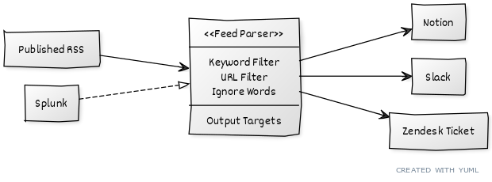

# RSS-Syphon

RSS-Syphon is an XML feed scraper that allows searching through returned RSS posts with customizable keywords.  
It helps identify security news, vulnerabilities, and incidents relevant to an organization's technologies and vendors.

Run this as a daily vulnerability intel job to provide general awareness based on relevant topics.

Feeds are grouped into configurable jobs, such as security news and CVEs.  
Matched results can be routed to Slack, Zendesk, Notion, or local files.

RSS-Syphon ships with a Splunk keyword-retrieval module and configurable SPL search for
supplementing static keywords with environment-specific package data. The
`get_splunk_results()` helper is available, although automatic invocation from
the standard RSS job runner has not been wired in.



## Features

- Fetch and parse multiple RSS feeds asynchronously  
- Keyword-based filtering with support for ignored terms  
- Lookback support to process older articles on new deployments  
- Integration with Slack, Notion, and Zendesk outputs  
- Splunk keyword retrieval via a configurable SPL query and reusable input module
- Robust error handling and logging  
- Modular outputs expansion supported

## Requirements

- Python 3.12 or 3.13 (Docker uses Python 3.13)
- Dependencies (install via `python -m pip install --require-hashes -r requirements.txt`):
  - aiohttp  
  - feedparser  
  - beautifulsoup4  
  - requests  
  - slack_sdk (if Slack integration is used)  
  - other dependencies as listed in `requirements.txt`
- Access and credentials for output platforms you intend to use (Slack, Zendesk, Notion)  
- Optional: Splunk access for dynamic keyword fetching

## Setup

1. Clone the repository  
2. Create and activate a Python virtual environment  
3. Install dependencies via `python -m pip install --require-hashes -r requirements.txt`
4. Copy the sanitized global configuration template and restrict the active copy:

   ```bash
   cp syphon.conf syphon.toml
   chmod 600 syphon.toml
   ```

5. Edit `syphon.toml` for global settings and `profiles/security/profile.toml`
   for jobs and routing; feeds and keywords live in adjacent TOML files.
   `syphon.toml` is local and Git-ignored;
   `syphon.conf` is the tracked template and must not contain credentials.
6. Set credentials as environment variables. For Docker, create a local `.env`
   file and use `--env-file`; direct Python execution requires variables already
   exported to the process environment. Neither Python nor RSS-Syphon loads
   `.env` automatically.
7. Validate the selected profile offline:

   ```bash
   python src/syphon.py --check-config
   ```

### Reproducible dependencies

`pyproject.toml` declares direct dependencies, while `requirements.txt` is a
generated lock with exact transitive versions and SHA-256 artifact hashes. The
lock supports Python 3.12 and 3.13. RSS-Syphon remains a script-based project;
the application is invoked through `src/syphon.py`.

To regenerate the lock intentionally (requires [uv](https://docs.astral.sh/uv/)):

```bash
uv pip compile pyproject.toml \
  --universal \
  --generate-hashes \
  --only-binary :all: \
  --no-binary splunk-sdk \
  --no-strip-markers \
  -o requirements.txt
```

The existing Splunk SDK currently requires a source distribution; its archive
is hash checked, but the install still builds that dependency. Review changes
to the lock before committing and audit it with:

```bash
uvx pip-audit --require-hashes --disable-pip -r requirements.txt
```

Documentation tooling is separate from runtime requirements. The `docs`
dependency group includes `diagrams` for `docs/diagramer.py`; the Graphviz
executable must also be installed to render diagrams. These tools are not
required by the production container or the runtime dependency lock.

### Docker validation

The image build installs the pinned dependencies and checks application imports.
A failed smoke test causes the build to fail.

```bash
docker build --pull --progress=plain -t rss-syphon:py313 .
docker run --rm --entrypoint python rss-syphon:py313 --version
```

These commands do **not** execute the RSS collection job. The Dockerfile should
copy the sanitized `syphon.conf` as `/app/syphon.toml`, never the private
`syphon.toml`. Running the image normally executes the configured feed jobs.
Live RSS and integration execution should be tested separately.

## Configuration

`syphon.conf` is the sanitized, tracked example. Copy it to the Git-ignored
`syphon.toml`, which the application actually reads. The active file owns global
module enablement, credential references, logging, and the
default profile. Profiles are stored in `[system].profiles_dir` (`./profiles` in
the supplied template), with configuration and datasets in separate TOML files:

```text
syphon.conf
syphon.toml
profiles/
  security/
    profile.toml
    feeds.toml
    keywords.toml
  local-land-work/
    profile.toml
    feeds.toml
    keywords.toml
```

- `[system].profiles_dir` can be an absolute path or a path relative to
  `syphon.toml`; the directory does not have to be named `profiles`. Profile
  names remain simple file handles (`--profile security` loads
  `security/profile.toml`).
- `[system].root_data_dir` controls where configured file outputs are stored
  (`./output` by default). Profile file paths are relative to that directory.
- `[modules].enabled` is the global allowlist. Profile routes referencing
  disabled modules are skipped with an INFO log, rather than failing the run.
  Add an output module as `src/rss_syphon/modules/<name>.py` with `dispatch()`;
  no Python registry needs updating.
- `[modules.<name>]` in `syphon.toml` holds global module defaults and shared
  credential references; profile-specific `[modules.<name>]` tables provide
  overrides such as destination settings.
  Global credentials remain authoritative. The loader retains the parameter
  shape expected by the existing integrations.
- `[jobs.<name>]` declares a feed job and its filtering options. A job only
  runs when explicitly declared, so the Local Land Work profile cannot run
  security's CVE job.
- `feeds.toml` holds `[feeds]` lists grouped by job type. `keywords.toml` holds
  `[keywords]` with shared match and ignore terms (one keyword per line for easy
  editing). These files are optional for profiles without jobs. The security
  profile provides a starter list of security news and vulnerability feeds.
- `[outputs]` lists destinations for each job. Slack, Notion, Zendesk, and
  `files` are output modules; Splunk is an input integration, not an output
  destination. `rss_syphon/modules/splunk.py` retains the complete keyword
  retrieval implementation (`get_splunk_results`) and the security profile
  retains its SPL and arguments. The job runner did not call that helper before
  the migration and still requires explicit wiring to incorporate its results.
  Existing destination-specific formatters expect supported `news`/`cve`
  result types.
- The `files` module is a normal, explicitly routed output. Set
  `[modules.files].destination = "stdout"` for JSON stdout or `"file"` to
  write one daily JSON snapshot per job (for example, `news-10-26-2026.json`).
  Repeated runs on the same day overwrite that day's snapshot and optional
  text report. `RSS_LOCAL_OUTPUT_FILE` still forces an exact filename and
  append-only NDJSON for existing scripts. There is no automatic fallback
  when other destinations fail or are disabled.
- Credentials use `env:VARIABLE_NAME` references. Keep actual values in the
  process environment, not TOML. Export `.env` locally or use Docker's
  `--env-file` (Python does not load `.env` automatically).
- `[system].log_level` and `log_format` configure logging globally. The existing
  `LOG_LEVEL` and `LOG_FORMAT` environment variables override these settings.

`rss_syphon/config.py` reads global and profile TOML, resolves paths and shared
credentials, and validates configuration. `rss_syphon/data.py` consumes that
result to load and validate `feeds.toml` and `keywords.toml`.
The CLI doesn't import feed or destination libraries during help or config validation.

All integrations live in `src/rss_syphon/modules/`. The CLI wrapper is
`src/syphon.py`; the package
also supports `python -m rss_syphon` when `src/` is on the Python path.

## Usage

Run daily to fetch and process RSS feeds:

```bash
python src/syphon.py
python src/syphon.py --profile security --check-config
python src/syphon.py --profile local-land-work --check-config
python src/syphon.py --profile security
```

Set `RSS_PROFILE=local-land-work` instead of passing `--profile` if preferred;
otherwise `[system].default_profile` selects the profile.
`--verbose` and `--quiet` temporarily override the configured log level.

You can also run inside Docker, supplying variables from your local `.env` file:

```bash
docker build -t rss-syphon .
docker run --rm --env-file .env rss-syphon
```

The image uses the sanitized template by default. To run with your customized
local `syphon.toml` without embedding it in the image:

```bash
docker run --rm --env-file .env \
  --mount type=bind,src="$PWD/syphon.toml",dst=/app/syphon.toml,readonly \
  rss-syphon
```

## Extending

- Add or remove RSS feeds in `[feeds]` inside the selected profile TOML.
- Modify `[keywords]` in the selected profile TOML.
- Add new output modules under `src/rss_syphon/modules/` using the `dispatch()` interface.

## Notes
  - Ensure network connectivity to RSS feed URLs  
  - Use valid API keys and tokens for outputs  
  - Lookback days parameter allows processing older articles when needed  

## Outputs Setup

Several outputs can be used alone or together and need to be configured prior to using them.

### Slack

Slack requires the following scopes:

```yaml
channels:history           # View messages and other content in public channels that syphon has been added to 
groups:history             # View messages and other content in private channels that syphon has been added to  
im:history                 # View messages and other content in direct messages that syphon has been added to  
incoming-webhook           # Post messages to specific channels in Slack  
mpim:history               # View messages and other content in group direct messages that syphon has been added to  
chat:write:bot             # Send messages as @syphon  
```

### Notion

Notion requires the following DB configuration for feed results:

```yaml
Property Name    Property Type
---------------------------------
Name             title
MD5_Hash         rich_text
Feed             rich_text
Type             rich_text
Keywords         multi_select
Article_Link     url
Summary          rich_text
CVE_Link         url
Submitted        date (or formula for current time)
```

Notion requires the following DB configuration for error results:

```yaml
Property Name    Property Type
---------------------------------
Name             title
Summary          rich_text
Submitted        date (or formula for current time)
```

### Zendesk

Zendesk requires an API key and group ID
